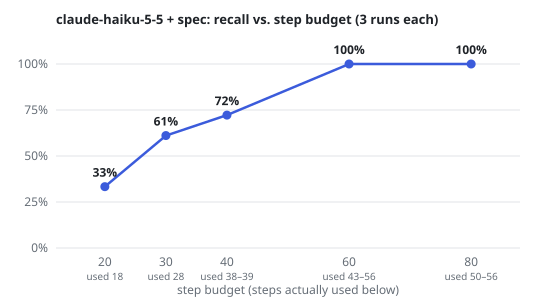

# WebProbe

A front-end QA agent that explores a web app in a real browser, finds bugs, and files
structured bug reports — plus an eval suite that measures how well (and how reliably) it does.

> Status: **week 3.** The test site, the browser tool server, the agent loop (Claude, Gemini or
> open models on Groq), the eval scorer and a run viewer all work. On the 10-bug site, Claude
> Opus 5.5 found every bug in all 3 runs (~$0.55 a run), Haiku 5.5 found 87% for 2 cents, and
> Sonnet 5.5 only 57% because it stops early. No false positives on the buggy site, one in two
> runs on the clean site, and three real bugs nobody seeded. Given the product spec, Haiku found
> all 12 bugs (including two only the spec defines) in 3 of 3 runs for 3 cents. Bug reports become
> Playwright regression tests that CI runs on every push ([Results](#results)).

## Layout

```
webprobe/
├── buggyshop/            Next.js shop with seeded, switchable bugs (the eval target)
│   ├── lib/bugs.ts       bug switches (NEXT_PUBLIC_BUGS)
│   └── bugs.manifest.json  ground truth for the eval — the agent never sees it
├── browser-mcp/          MCP server: the agent's only way to touch the browser
│   ├── src/server.ts     tools: navigate, snapshot, click, type, console_errors, network_errors
│   └── src/smoke-test.ts scripted run that reproduces every v0.1 bug through the tools
├── agent/                hand-written agent loop (MCP client + model providers)
│   ├── src/agent.ts      the loop: budgets, stuck detection, wrap-up turns
│   ├── src/providers/    claude.ts, gemini.ts, groq.ts behind one small interface
│   ├── src/tools.ts      report_bug and finish, the agent's own tools
│   ├── src/run.ts        one run against BuggyShop → runs/<time>/report.json + screenshots
│   └── src/eval.ts       scores runs against the manifest (tests in test/)
└── viewer/               Next.js app to browse runs: scores, bug reports, step timeline
```

## Run it

```bash
# 1. the test site (all bugs on)
cd buggyshop && npm install && npm run dev        # http://localhost:3000
#    clean site for false-positive runs:  npm run dev:clean
#    a subset:  NEXT_PUBLIC_BUGS=cart-zero-qty,coupon-500-silent npx next dev -p 3000

# 2. the browser MCP server (in another terminal)
cd browser-mcp && npm install && npx playwright install chromium
npm run smoke                                      # 16 checks; exits 1 if any fail
```

```bash
# 3. the agent: put one of ANTHROPIC_API_KEY, GEMINI_API_KEY, GROQ_API_KEY in agent/.env
cd agent && npm install && npm start
#    provider: WEBPROBE_PROVIDER=claude|gemini|groq (default: the first one with a key)
#    model:    WEBPROBE_MODEL (defaults: claude-opus-5-5, gemini-3.8-flash, openai/gpt-oss-120b)
#    budgets:  WEBPROBE_MAX_STEPS (40), WEBPROBE_MAX_COST_USD (2), WEBPROBE_EFFORT (medium)
#    prompt:   WEBPROBE_PROMPT=budget  (tell the model its step budget; see Results)
#    gate:     WEBPROBE_COVERAGE_GATE=1  (refuse finish while linked pages are unopened)
#    spec:     WEBPROBE_SPEC=../buggyshop/SPEC.md  (give the agent the product spec)
#    against the clean site, tell the eval: WEBPROBE_LIVE_BUGS=none npm start

# 4. score runs
npm run eval -- runs/<dir> runs/<dir> ...           # recall, precision, false positives
npm test                                           # tests for the scorer and page tracking
npm run sweep -- --spec                            # recall and cost by step budget (--out chart.svg)

# 5. turn a run's bug reports into Playwright regression tests
#    needs the clean site too:  cd buggyshop && npm run dev:clean-side   (http://localhost:3002)
npm run gen-tests -- runs/<dir>                     # writes runs/<dir>/tests/; model: claude-haiku-5-5
npm run promote-tests -- runs/<dir> ...            # copies valid ones to buggyshop/tests/regression/

# the regression suite (no API key; Playwright builds and starts its own copy of the shop)
cd buggyshop && npm run test:regression            # clean site: all must pass
npm run test:regression:buggy                      # all bugs on: all should fail

# 6. browse runs
cd viewer && npm install && npm run dev            # http://localhost:3001
```

If `npx playwright install` can't download Chromium, use your installed Chrome:
`WEBPROBE_BROWSER_CHANNEL=chrome npm run smoke`.

### Use it from an MCP host

`browser-mcp` is a standard stdio MCP server: register it with command `npx tsx src/server.ts`
(working directory `browser-mcp/`), then ask the host to explore http://localhost:3000.
So far it has been exercised by `smoke-test.ts` through the MCP client SDK, not yet from a desktop host.

## Seeded bugs

| id | category | page | what's wrong |
|---|---|---|---|
| `cart-zero-qty` | functional | /cart | qty → 0 keeps the item; total unchanged |
| `signup-email-validation` | validation | /signup | accepts `not-an-email` |
| `product-img-alt` | a11y | / | product images have no alt text |
| `coupon-500-silent` | network | /cart | coupon API returns 500, page shows nothing |
| `reviews-tab-typeerror` | console | /product/* | Reviews tab throws TypeError, never opens |

Added in v0.2, deeper in the site and needing more steps or some arithmetic to spot:

| id | category | page | what's wrong |
|---|---|---|---|
| `search-case-sensitive` | functional | / | search for "mug" finds nothing; "Mug" works |
| `sort-price-string` | functional | / | "Price: low to high" gives $14, $39, $9 (compares text) |
| `checkout-free-shipping` | functional | /checkout | $53 of items still pays $5 shipping (checks item count, not price) |
| `checkout-zip-unlabeled` | a11y | /checkout | ZIP code field has no accessible name |
| `order-link-404` | network | /checkout, /order/* | "View order" after placing an order goes to a 404 |

Added in v0.3, wrong only according to the product spec ([SPEC.md](buggyshop/SPEC.md)); no page
states the rule (`spec_only` in the manifest):

| id | category | page | what's wrong |
|---|---|---|---|
| `bulk-discount-missing` | functional | /cart | 10 or more of one product should get 10% off; nothing is taken off |
| `order-cart-not-cleared` | functional | /checkout | after an order is placed, the cart keeps its items |

A bug's `page` can be a list when it can fairly be reported from more than one page. Runs record
the exact bugs that were live, so runs from v0.1 still score out of 5.

## Browser MCP server

| tool | notes |
|---|---|
| `navigate(url)` | only origins in `WEBPROBE_ALLOWED_ORIGINS` (default `http://localhost:3000`) |
| `snapshot()` | accessibility tree with element refs (`[ref=e5]`, `[ref=f2e16]` after navigation), capped by `WEBPROBE_MAX_SNAPSHOT_CHARS`; images with no accessible name are listed separately |
| `click(ref)` | click the element with that ref |
| `type(ref, text, submit?)` | replace a field's value; optionally press Enter |
| `console_errors()` | console errors/warnings + uncaught exceptions since the last call |
| `network_errors()` | failed, 4xx/5xx and blocked requests since the last call |
| `screenshot()` | PNG of the visible page. The agent hides it from the model and takes one itself for each bug filed |

Design choices:
- **Rules live in the tool server, not the prompt.** Off-site requests are blocked at the
  network layer (`context.route`), so a click on an outside link can't leave the site either.
- **Small context.** Snapshots are accessibility trees, not HTML. The AI-mode tree drops images
  that have no accessible name, so `snapshot` lists those separately instead of losing them.
- **Errors go back to the model.** Tool failures return `isError` with a next step
  ("refs change whenever the page updates — call `snapshot`"), rather than throwing.
- **Wait for the page to settle.** After `click`/`type` the server waits until no request has
  been in flight for 300 ms (max 3 s), so `network_errors` sees requests the action started.
- Logs go to stderr because stdout carries the MCP protocol.

## Agent loop

Written by hand instead of with a framework or the SDK's tool runner, so every decision is visible:

- **Any model.** The loop talks to a small `Provider` interface; `providers/claude.ts`,
  `gemini.ts` and `groq.ts` own each API's message format. The MCP tools don't change at all.
- **Two kinds of tools.** Browser tools come from the MCP server (`tools/list` maps almost 1:1
  onto model tool definitions). `report_bug` and `finish` run in the agent process: they are
  how results come back, so the bug list is structured data, not prose to parse.
- **Hard stops.** A step budget and a dollar budget, computed from the API's token usage.
  Three steps before the end the agent is told to file what it has and finish. After the last
  step it gets up to five report-only turns (browser tools disabled), so a model that explores
  to the very end still files what it saw.
- **Stuck detection.** The same call three times in a row gets a note telling it to change course.
- **History: append-only, except where it can't be.** Claude and Gemini get the history
  exactly as it happened: that keeps the prompt cache valid, and both reject edited history
  that carries their signed reasoning. Groq's free tier allows ~8K tokens a minute, so the Groq
  provider masks all but the last two tool results. The cost shows up in the runs: by the time
  the model writes its reports, the snapshot that showed the bug may already be masked.
- **Failures keep results.** Dropped connections and per-minute rate limits are retried; a
  daily quota stops the run at once. A run that fails still writes what it found.
- **Least privilege.** The MCP server process does not get the API key.
- **Generic prompt.** The system prompt describes how a QA engineer works, not the seeded bugs.
  Naming them would score well here and teach nothing about other sites.

## Eval

`bugs.manifest.json` gives each seeded bug a `match` regex. A report finds a bug when it is on
the bug's page (`*` and route parameters match any one segment) and the regex hits its title, actual or evidence; each bug counts once, further
reports of it are duplicates. A report of a real defect that was *not* seeded, once a person
has confirmed it in the code, goes in the manifest's `extras`: it counts as correct for
precision and stays out of recall. Extras match on a report's page and title only, because
evidence often shows other problems on the same page. Anything else is a false positive (on the clean site, every
report but extras). Keyword matching is crude, so false positives are listed for a human to
check rather than trusted. The agent never sees the manifest, and BuggyShop exposes no way to read it.

## Results

### v0.3: a product spec (12 bugs)

An agent with no spec can only flag what contradicts the page itself or common sense: "$5
shipping" on a page that says "free over $50," a search that misses "mug." It cannot know a rule
that lives only in a product doc. So `WEBPROBE_SPEC` puts a spec in the system prompt, written as
a product manager would ([SPEC.md](buggyshop/SPEC.md): features and Given/When/Then rules, not
known bugs), and two bugs were added that only the spec makes wrong.

Haiku 5.5, 3 runs per row:

| | recall (mean) | `bulk-discount-missing` | `order-cart-not-cleared` | steps used | cost / run |
|---|---|---|---|---|---|
| no spec, 40 steps | 83% | 0/3 | 3/3 | 32–38 | $0.02 |
| spec, 40 steps | 72% | **3/3** | 0/3 | 38–39 | $0.02 |
| no spec, 60 steps | 75% | 0/3 | 2/3 | 33–35 | $0.02 |
| **spec, 60 steps** | **100%** | **3/3** | **3/3** | 43–56 | $0.03 |

- The spec-only bug is found only with the spec, every time, as expected.
- With the spec but the same 40 steps, recall *fell*: Haiku checked each rule more carefully
  (both sort directions, valid and invalid coupons, a quantity of 10) and ran out of steps before
  it placed an order or opened the signup page.
- More steps alone don't help: without a spec, Haiku stops by itself at about 35 of 60.
- Together, Haiku found all 12 bugs in all 3 runs. The spec works as an answer key for rules and
  as a checklist that keeps the agent going, which is the depth the Sonnet experiments showed was
  missing.

**How many steps?** The 40-step default was a first guess, not a tuned number. A sweep with the
spec (Haiku, 3 runs per budget, `npm run sweep -- --spec --out ../docs/step-sweep.svg`):



| budget | recall | steps used | cost / run |
|---|---|---|---|
| 20 | 33% | 18 | $0.006 |
| 30 | 61% | 28 | $0.012 |
| 40 | 72% | 38–39 | $0.020 |
| 60 | 100% | 43–56 | $0.030 |
| 80 | 100% | 50–56 | $0.030 |

Up to 40 the budget is the limit: every run uses all of it. From 60 the agent stops by itself
at 43–56 steps, so a bigger budget buys nothing. With a spec, about 60 steps is the knee; without
one, Haiku stops at about 35 whatever the budget, so 40 is enough. The budget that fits depends on
how much the agent is asked to check.

**Watching the budget in use.** A fixed number goes stale as the app grows, so the viewer shows,
per model and setting, how many runs used their whole step budget ("Hit budget"; a run counts
once it reaches the 3-steps-left warning). Above 20% it turns red: raise the budget or split the
run by area. On the data so far it is 3/3 with the spec at 20–40 steps and 0/3 at 60–80, which
is the sweep's knee, and 2/3 for Opus and Haiku on the 10-bug site at 40, which was tight already.

**Spec coverage.** With a spec, `finish` has to account for every rule: pass, fail or not tested.
The loop checks each claim against the pages the agent opened, so "pass" on a page it never
visited is flagged; the viewer shows the table per run. In 5 runs (Haiku, spec), each listed 23–27
rules and none claimed a page it hadn't opened. Both 40-step runs missed the signup bug, and both
reports said the two signup rules were "not tested": the report shows where the budget ran out.
The count of rules differs by run because the agent splits the spec itself; numbered rules in
the spec would make coverage comparable across runs. (Those two 40-step runs found 11 of 12;
the earlier three found 72% on average. Two runs aren't enough to say the new finish
instruction is why.)

Caveats: the spec describes most features, so it also spells out behavior for several seeded
bugs (case-insensitive search, for one). Spec runs filed more duplicates (1–5 a run, reporting
each sort direction or coupon case separately). Two no-spec 60-step runs died on a network error
to the API and were rerun.


### v0.2: 10 bugs

Three Claude models, 40-step budget, BuggyShop with all 10 bugs on, 3 runs each:

| | Haiku 5.5 | Sonnet 5.5 | Opus 5.5 |
|---|---|---|---|
| recall (mean) | 87% (90, 70, 100) | 57% (50, 60, 60) | **100%** (every run) |
| precision | 100% | 100% | 100% |
| steps per run | 36–38 | **10–16** | 36–38 |
| time per run | ~1.5 min | ~35 s | ~2 min |
| cost per run | **~$0.02** | ~$0.08 | ~$0.55 |

| bug | Haiku | Sonnet | Opus |
|---|---|---|---|
| `cart-zero-qty` | 3/3 | 3/3 | 3/3 |
| `coupon-500-silent` | 3/3 | 3/3 | 3/3 |
| `reviews-tab-typeerror` | 3/3 | 3/3 | 3/3 |
| `signup-email-validation` | 1/3 | 3/3 | 3/3 |
| `product-img-alt` | 2/3 | **0/3** | 3/3 |
| `search-case-sensitive` | 3/3 | **0/3** | 3/3 |
| `sort-price-string` | 3/3 | 3/3 | 3/3 |
| `checkout-free-shipping` | 3/3 | **0/3** | 3/3 |
| `checkout-zip-unlabeled` | 2/3 | 2/3 | 3/3 |
| `order-link-404` | 3/3 | **0/3** | 3/3 |

The cheapest model beat the middle one. Sonnet stops after 10–16 of its 40 steps, and its
summaries say so ("I did not test checkout or search"), so it never reaches the bugs deeper in
the site. Haiku and Opus use nearly the whole budget. On this kind of task, how long a model
keeps exploring matters as much as how well it reasons, and one run per model would not have
shown it: Sonnet misses the same four bugs every time.

Is it the budget or the model? Steps undersell the gap: Sonnet makes ~3 tool calls per step, but
it still takes about 20 browser actions (navigate, click, type) per run where Haiku and Opus take
45–50. A prompt variant (`WEBPROBE_PROMPT=budget`) tells the model its step budget and asks it to
list what it has not tested before finishing. With it, Sonnet takes 14–18 steps and recall goes
from 57% to **67%** (70, 60, 70; 3 runs, $0.10 a run). It now always tests search and sort, but it
still writes "I did not test checkout" and calls finish anyway, so `order-link-404` stays at 0/3.

A harness rule instead of a prompt: with `WEBPROBE_COVERAGE_GATE=1` the loop collects every
same-site link in the snapshots and refuses `finish` (up to 3 times, while more than 3 steps are
left) if any linked page was never opened. It reads the tools' output, not anything about
BuggyShop. With it, Sonnet opened **every page in all 3 runs**, and recall stayed at **57%**
(60, 50, 60). It opened /checkout and looked, but never placed an order, typed a lowercase
search, added $50 of items or checked image names. The gap is depth, not breadth: visiting a page
is not testing it. A gate on pages is easy to satisfy; a gate on behaviour would need to know
what the page does, which is the tester's job.

### v0.1: 5 bugs

Same setup with the first 5 bugs:

| | Haiku 5.5 | Sonnet 5.5 | Opus 5.5 |
|---|---|---|---|
| recall (mean) | 73% (80, 60, 80) | 80% (80, 80, 80) | **100%** (every run) |
| precision | 100% | 100% | 100% |
| cost per run | ~$0.01 | ~$0.06 | ~$0.38 |

Sonnet never checked alt text (0/3); Opus also tried negative and fractional quantities, an empty
coupon, a product that does not exist and a reload. Haiku's prompt caching turned ~94% of input
tokens into cache reads.

On the v0.1 clean site (every seeded bug off), Haiku, 2 runs: **5 reports, 1 false positive** (an empty
coupon code gets "not valid" and a server round trip, which is arguably fine). The other 4 were
real defects that were not seeded, including a third one found only here: after a valid coupon,
an invalid one shows an error but leaves the old discount in the total.

Two things the runs showed:
- **Agents overstate their coverage.** One run's summary says it tested an invalid email; its
  tool calls show it never typed one, and that run missed the signup bug. The eval reads tool
  calls and reports, never the summary.
- **The eval needs checking too.** The first scoring pass credited "accepts 2.5 mugs" as the
  zero-quantity bug (the pattern only asked for "quantity"), and an earlier one called a correct
  report a false positive because the manifest pinned a bug to one product page when it is on
  all of them. Both were fixed in the manifest, with a test for each.

### First runs on free tiers

Against BuggyShop with all 5 bugs on:

| model | steps | found | what happened |
|---|---|---|---|
| gemini-3.8-flash | 17 | 1 (`reviews-tab-typeerror`, step 14) | hit the free tier's 20 requests/day; the report was lost to the crash, which is why runs now save what they have on failure |
| openai/gpt-oss-120b (Groq) | 40 | 0 | saw the coupon 500 in `console_errors`, never filed it; ignored the 3-steps-left note |
| openai/gpt-oss-120b (Groq) | 41 | 0 | set a quantity to 0 and saw the item stay at `Total: $28.00`; ended with "no issues found" |
| qwen/qwen3.8-27b (Groq) | 19 | 0 | one reply needed more than the free tier's 1,000 output tokens a minute |
| gemini-3.5-flash-lite (15-step budget to fit the daily quota) | 16 | 1 (`reviews-tab-typeerror`), 0 false positives | finished on its own in 17 s; reported the bug on /product/notebook as `/product/[id]` |

The lite run also caught a bug in the ground truth: the manifest pinned the reviews bug to
/product/mug, but it lives in a component every product page uses. Manifest pages now take
`*` segments, and a report's route parameters (`[id]`, `:id`) match any segment.

What they show: the plumbing holds up across three APIs, but the open models on Groq saw bug
evidence and did not recognise it as a bug.

## Regression tests from bug reports

A bug report tells you something broke once; a test keeps it fixed. `gen-tests` asks a model to
turn each report into a Playwright test (`@playwright/test`, role and label locators), using the
report, the agent's actions with element refs resolved to names ("click button \"Apply\""), and
the last snapshot of each page.

The model only gets what a team would have before the fix: the buggy build. Its test has to
fail there; it reads the failure and either confirms it is the bug or fixes a broken test (up to
3 writes). Then the clean site judges it once, with nothing sent back: a **valid** test fails
with the bug and passes without it.

Haiku writing tests for 4 runs (3 Opus, 1 Haiku), 43 reports:

| | |
|---|---|
| valid, of 40 reports of seeded bugs | **32 (80%)**, about $0.002 a test |
| valid tests that also fail with *only their own* bug on | 32 of 32 (a one-off check with one bug live at a time) |
| tests for the unseeded fractional-quantity bug | 3 of 3 fail on the clean site too, which is right: the bug is there |
| Sonnet instead of Haiku, same 10 reports | 8 of 10 valid, at 13x the cost |

The misses are one kind of mistake: a test written against the broken app asserts details of the
broken app. "View order" tests check the URL is `/order/1001` (the bad link the agent followed; the
real page is `/orders/1001`) in 4 of 4 runs, even though the prompt says not to. Others expected
"$0.00" where the fixed checkout says "Free", or kept typing into a quantity box that the fix
removes. A first version of the loop sent the clean site's output back to the model and reached
10 of 10, but no team has the fixed app while writing the test, so that number was not honest.

The viewer shows each test under its bug, with its status.

### From a run to CI

`promote-tests` copies the valid tests into `buggyshop/tests/regression/`, one file per bug
(named by the bug the eval matched), and never overwrites a file that is already there, since
someone may have reviewed it. That's the human step: read the diff, then commit. Nine of the ten
bugs have a test there now; `order-link-404` never got a valid one.

[CI](.github/workflows/ci.yml) runs on every push and pull request, with no API key:

| job | checks |
|---|---|
| `agent-tests` | typecheck, scorer and page-tracking tests |
| `regression` | the suite on a production build of the clean shop: every test passes. This is the gate. |
| `regression-catches-bugs` | the suite with every bug on: every test fails. A test that starts passing here no longer catches its bug. |

So the model is paid once, when it writes a test (about $0.002); after that the test runs on
every change for free, in about 10 seconds for all nine.

## Roadmap

- [x] BuggyShop with 5 switchable bugs + ground-truth manifest
- [x] MCP server: `navigate`, `snapshot`, origin allowlist, smoke test
- [x] tools: `click`, `type`, `console_errors`, `network_errors`; network-level origin blocking
- [x] tool: `screenshot`, attached to every bug report
- [x] agent loop (hand-written) with step/cost budgets and stuck detection
- [x] `BugReport` schema (zod) for structured output
- [x] providers: Claude, Gemini, Groq
- [x] eval scorer (recall, precision, duplicates, false positives) with tests
- [x] run viewer
- [x] first runs on free tiers
- [x] 3 runs each on Claude Haiku, Sonnet and Opus 5.5: recall 73% / 80% / 100%, precision 100%
- [x] 5 harder bugs (search, sort, checkout, order page); same 3 models: 87% / 57% / 100%
- [x] Sonnet experiments: budget prompt 67%, page-coverage gate 57% (every page opened)
- [x] regression tests from bug reports, judged on the clean site: 80% valid
- [x] promoted into a regression suite that CI runs on every push
- [x] product spec mode: Haiku with spec and 60 steps finds 12/12 (3/3 runs)
- [x] step-budget sweep (20–80): the knee is about 60 with a spec
- [x] budget-hit rate in the viewer; spec coverage report checked against the trace
- [x] false-positive runs on the clean build: 1 false positive in 2 runs
- [ ] keep bug evidence when old tool results are masked (e.g. a notes tool)
- [ ] 35 bugs + 10 clean pages + 3 prompt-injection pages; dev/test split
- [ ] eval runner: recall, precision, pass^k, injection resistance, cost per run
- [ ] tracing (Langfuse) and a trace-replay UI
